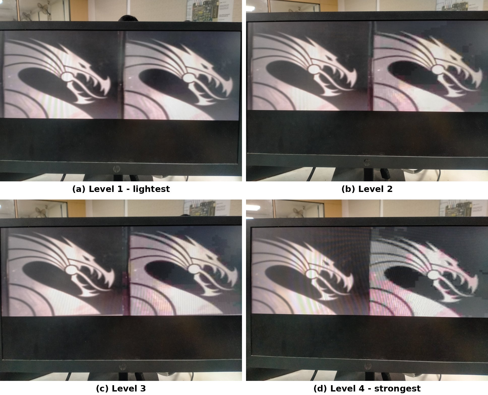
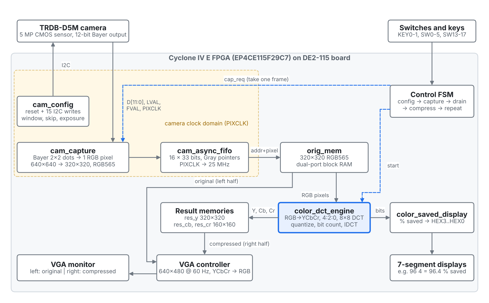
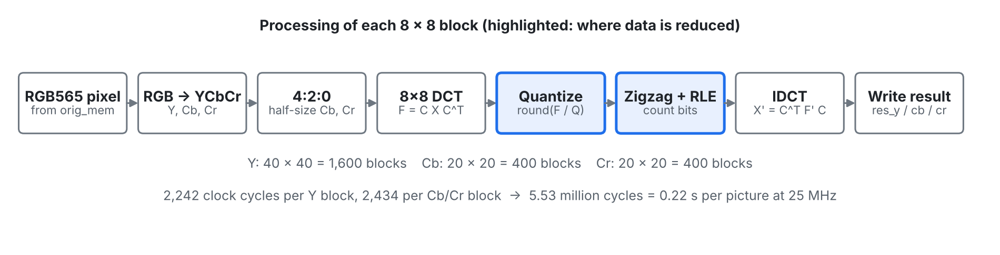
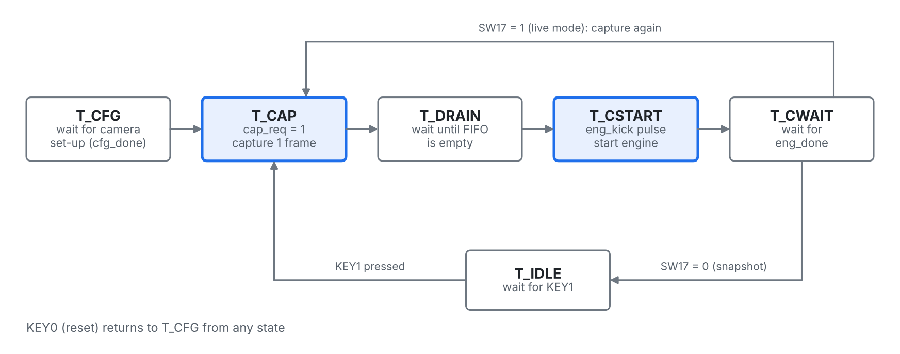
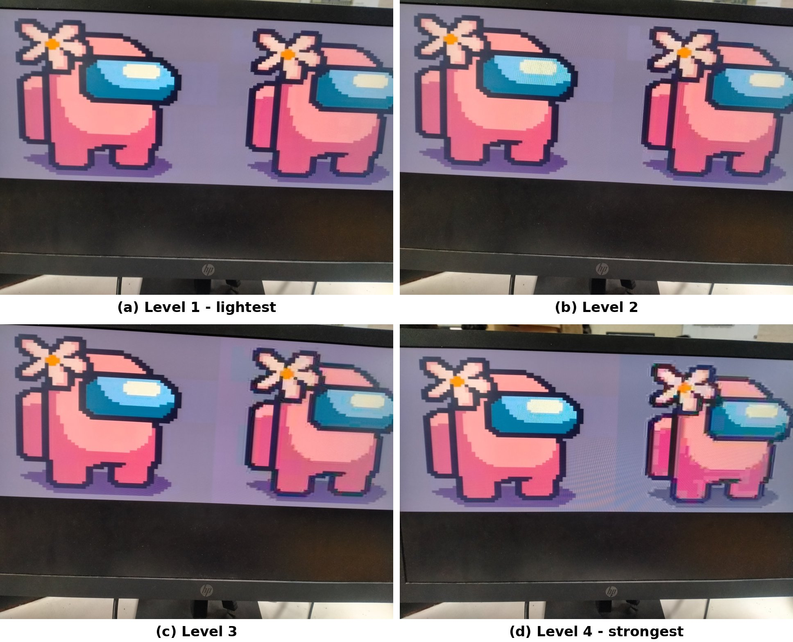
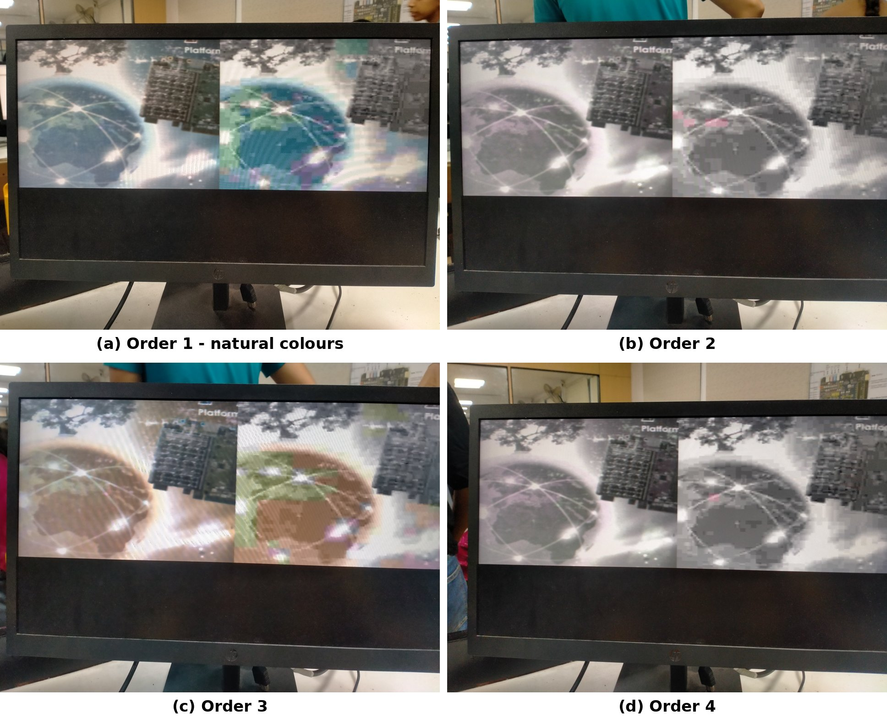
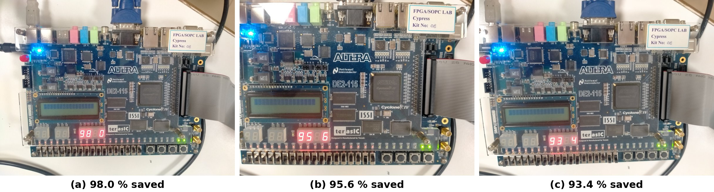
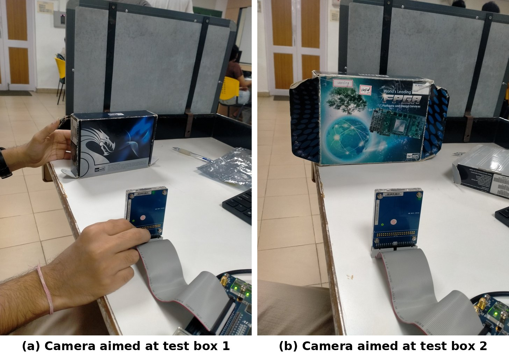

# Real-Time JPEG-Style Colour Image Compression on FPGA

A live camera picture is captured, compressed in hardware using the core steps of JPEG, and shown next to the original on a VGA monitor. The memory saved is shown on the seven-segment displays. Everything is written in **Verilog HDL only**: no IP cores, no soft processor.

**Platform:** Terasic DE2-115 (Altera Cyclone IV E EP4CE115F29C7) + TRDB-D5M 5 MP camera + VGA monitor



## Features

- **Live camera input.** The TRDB-D5M is configured over I2C by our own Verilog I2C master. Its Bayer output is converted to 320 x 320 RGB pixels.
- **Snapshot and live modes.** KEY1 takes one picture. With SW17 on, the board keeps capturing and compressing, about 3-4 pictures per second.
- **JPEG-style colour compression.** RGB to YCbCr, 4:2:0 chroma subsampling, 8 x 8 DCT, standard JPEG luminance and chrominance quantization tables, zigzag scan, run-length bit counting, inverse DCT.
- **Four compression levels** (SW1-SW0): quantization tables scaled by 1, 2, 4 or 8.
- **Side-by-side display.** VGA 640 x 480 at 60 Hz, original on the left, compressed on the right.
- **Memory saved** shown in percent with one decimal place on HEX3-HEX0.
- **Hardware-efficient.** One shared multiplier for all DCT/IDCT work, no dividers (multiply and shift instead), fixed-point arithmetic, and an asynchronous FIFO for the camera clock crossing. All memory is on-chip.

## Block diagram



| Module | Clock | Role |
|---|---|---|
| [`cam_jpeg_top.v`](rtl/cam_jpeg_top.v) | 25 MHz | Top-level entity: board pins, control FSM, memories, VGA controller, YCbCr to RGB |
| [`cam_config.v`](rtl/cam_config.v) | 25 MHz | Camera reset and I2C master that writes 15 camera registers |
| [`cam_capture.v`](rtl/cam_capture.v) | PIXCLK | Captures exactly one frame, converts each 2 x 2 Bayer group to one RGB565 pixel |
| [`cam_async_fifo.v`](rtl/cam_async_fifo.v) | PIXCLK / 25 MHz | 16 x 33-bit asynchronous FIFO with Gray-code pointers |
| [`color_dct_engine.v`](rtl/color_dct_engine.v) | 25 MHz | Compression engine: YCbCr, 4:2:0, DCT, quantization, bit count, IDCT |
| [`color_saved_display.v`](rtl/color_saved_display.v) | n/a | Converts the bit count to % saved and drives the seven-segment displays |

## How the compression works



1. **Colour conversion.** Each pixel becomes Y (brightness), Cb and Cr (colour). Cb and Cr are averaged over 2 x 2 pixels and kept at 160 x 160, because the eye notices colour detail far less than brightness detail. This alone saves 50 %.
2. **8 x 8 DCT.** Each block is transformed with F = C X C<sup>T</sup>, computed as two 8 x 8 matrix multiplications with fixed-point constants (x 4096).
3. **Quantization.** Each coefficient is divided by the JPEG table (multiply by a stored reciprocal, then shift) and rounded. Most high-frequency values become zero. This is where data is discarded.
4. **Zigzag + run-length bit count.** DC difference coding, 8-bit (run, size) symbols, ZRL and end-of-block symbols give the compressed size.
5. **IDCT.** The quantized block is transformed back, so the right half of the screen shows what a decoder would rebuild.

Y is processed as 1,600 blocks and Cb, Cr as 400 blocks each. One picture takes 5.53 million clock cycles, which is **0.22 s at 25 MHz**.

## Controls

| Control | Function |
|---|---|
| KEY0 | Reset: configure the camera again, capture and compress |
| KEY1 | Take one new picture and compress it (snapshot mode) |
| SW17 | 1 = live mode, 0 = snapshot mode |
| SW16-SW13 | Camera exposure, 0000 darkest to 1111 brightest (press KEY0 after changing) |
| SW3-SW2 | Bayer colour order (pick the setting with natural colours) |
| SW1-SW0 | Compression strength: 00 light, 01 medium, 10 strong, 11 very strong |
| LEDG0 / LEDG1 / LEDG2 | Compression finished / camera configured / capturing |
| HEX3-HEX0 | Memory saved, e.g. `96 4` = 96.4 %; dashes while compressing |



## Repository layout

```
rtl/            Verilog source (6 modules, top = cam_jpeg_top)
sim/            ModelSim test bench for the compression engine
constraints/    cam_pins.tcl - all 129 DE2-115 pin assignments
docs/           Project report and part-by-part explanation of every module
docs/images/    Block diagram, pipeline, FSM, board photo
results/        Photos of the working system
```

## Build and run

**Requirements:** Quartus Prime (tested with 25.1 Standard Edition), DE2-115 board, TRDB-D5M camera on the GPIO header, VGA monitor.

1. Create a Quartus project for device **EP4CE115F29C7** and add all files in `rtl/`.
2. Set **cam_jpeg_top** as the top-level entity.
3. Run `constraints/cam_pins.tcl` from **Tools > Tcl Scripts**.
4. Compile with **Processing > Start Compilation**.
5. Program the board with **Tools > Programmer** (`cam_jpeg_top.sof`).
6. Connect the camera with the board switched off, matching pin 1 on both ends of the ribbon cable.

## Simulation

The test bench feeds a known 320 x 320 picture to the compression engine and prints the compressed size, the memory saved and sample decompressed pixels.

```
cd sim
vlib work
vlog ../rtl/color_dct_engine.v tb_color_dct_engine.v
vsim -gTEST=2 -gQUALITY=0 tb_color_dct_engine
run -all
```

`TEST=1` is a uniform gray picture and `TEST=2` is a vertical black/white edge. `QUALITY` matches SW1-SW0.

## Results

| Measure | Value |
|---|---|
| Image size | 320 x 320, 24-bit colour (2,457,600 bits) |
| Memory saved | 93.4 % to 98.0 % measured on the board, depending on the scene and the SW1-SW0 setting |
| Compression time | 0.22 s per picture at 25 MHz |
| Live mode | about 3-4 pictures per second |
| On-chip memory | about 2.87 Mbit (about 350 of 432 M9K blocks) |

### Four compression levels (SW1-SW0 = 00, 01, 10, 11)



### Four Bayer colour orders (SW3-SW2), order 1 gives natural colours



### Memory saved on the seven-segment display



### Setup



**Limitation:** the compressed size is counted with fixed 8-bit run-length symbols. A complete JPEG encoder would add Huffman coding and save a further 20-30 %. A faster, parallel DCT would allow full-speed video.

## Team

Mini project, Digital System Design with FPGA, Vellore Institute of Technology.

| Name | Register No. |
|---|---|
| Aditya Prakash Chaurasia | 26MVD0090 |
| Abinash R | 26MVD0104 |
| Dev Vijay | 26MVD0093 |

Submitted to: Jagannadha Naidu K
